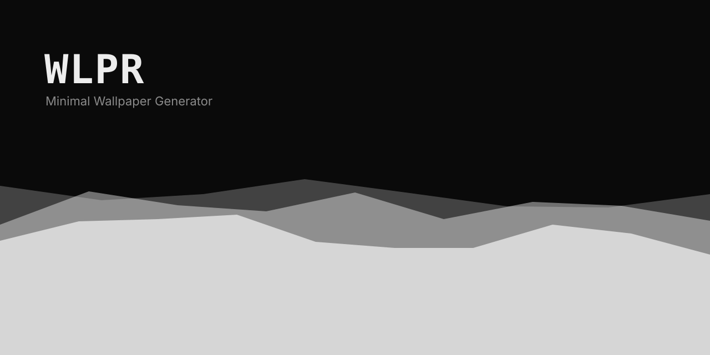
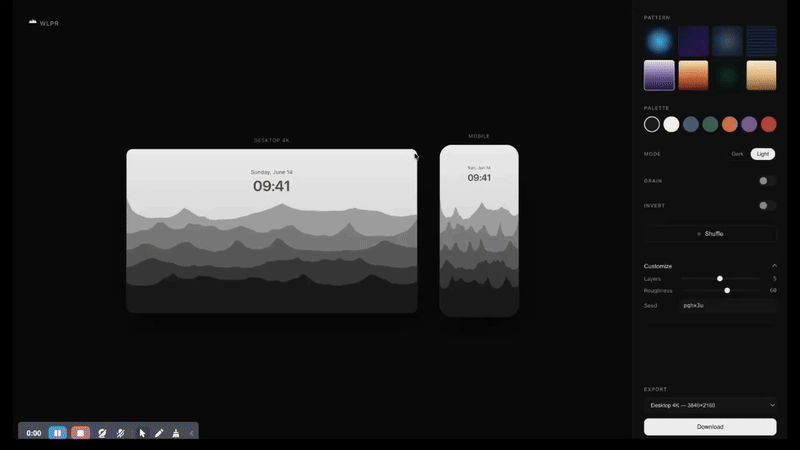

<p align="center">
  
</p>

<p align="center">
  <a href="https://aaryanraj007.github.io/WLPR/">
    
  </a>
</p>

<h1 align="center">WLPR — Minimal Wallpaper Generator</h1>

<p align="center">
  <b>A procedural, minimal, browser-based wallpaper generator built with HTML5 Canvas 2D & TypeScript.</b>
</p>

<p align="center">
  <a href="https://aaryanraj007.github.io/WLPR/"></a>
  
  
  
</p>

<br/>

<p align="center">
  
</p>

---

## ✨ Overview

**WLPR** is a procedural wallpaper engine designed for users who love clean, dark-mode, and minimalist aesthetics. Instead of downloading static stock photos or generic gradients, WLPR generates unique mathematical and geometric wallpapers directly inside your browser.

Every wallpaper is 100% deterministic — driven by a seeded pseudo-random number generator (PRNG). If you generate a wallpaper you love, the exact configuration and seed are encoded directly into the URL hash so you can bookmark, save, or share it anytime.

👉 **Try it live**: [https://aaryanraj007.github.io/WLPR/](https://aaryanraj007.github.io/WLPR/)

---

## 🎨 Features & Patterns

### 🌌 8 Procedural Pattern Engines
- **Constellation Mesh**: Minimalist vector dot nodes connected by high-density laser line networks.
- **Curved Waves**: Sleek lower-horizon sweeping single-color wave curves.
- **Connected Squares**: Ultra-clean corner-to-corner square lattice geometry.
- **Topographic Line Art**: Organic contour elevation maps.
- **Ridgeline**: Layered mountain silhouette horizons.
- **Horizon**: Banded sunset gradients.
- **Dunes**: Soft, warped desert sand dunes.
- **Flow Field**: Curled vector flow lines.

### 🌈 OKLCH Color Engine & Invert Mode
- **7 Curated Palettes**: `Mono`, `Cream`, `Slate`, `Forest`, `Amber`, `Violet`, and `Rust`.
- **Soft Cream Palette**: Dreamy warm vanilla, oatmeal, and latte tones without harsh darks.
- **Universal Invert Toggle**: Reverses background and element colors instantly across every pattern.
- **Dark / Light Mode**: Changes the entire mood of the generated artwork.

### ⚡ Technical Highlights
- **Zero-Lag Web Worker Exports**: Renders high-resolution 4K (3840×2160), 2K, 1080p, and Mobile (1290×2796) wallpapers off the main UI thread.
- **Mobile First Viewport**: Responsive single-screen layout (`100dvh`) with zero vertical scrolling on mobile devices.
- **Url & Local Storage Persistence**: Remembers your active pattern, seed, sliders, and color settings.

---

## 🛠️ Stack & Architecture

| Technology | Usage |
| :--- | :--- |
| **Language** | Vanilla TypeScript (`strict` mode) |
| **Bundler** | Vite 6 |
| **Graphics** | HTML5 Canvas 2D API & Web Workers |
| **Color Math** | OKLCH color space via [culori](https://culorijs.org/) |
| **Procedural Noise** | 2D Simplex Noise via [simplex-noise](https://github.com/jwagner/simplex-noise.js) |
| **PRNG** | Seeded Mulberry32 random number generator |

---

## 💻 Running Locally

Clone the repository and start the Vite local development server:

```bash
# Clone the repository
git clone https://github.com/AaryanRaj007/WLPR.git
cd WLPR

# Install dependencies
npm install

# Start local dev server
npm run dev
```

Open [http://localhost:5173](http://localhost:5173) in your browser.

To build the production static bundle:

```bash
npm run build
```

---

## 📄 License

Distributed under the MIT License. Built with ❤️ by [AaryanRaj007](https://github.com/AaryanRaj007).
